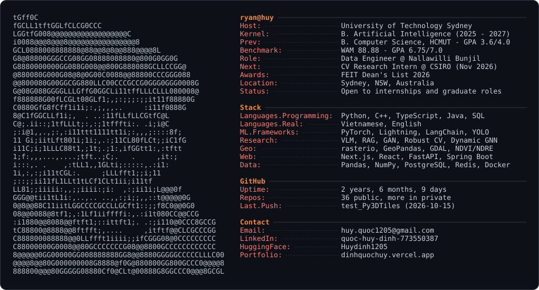

  <picture>
    <source media="(prefers-color-scheme: dark)" srcset="assets/huy-ascii-card.svg">
    <source media="(prefers-color-scheme: light)" srcset="assets/huy-ascii-card-light.svg">
    
  </picture>

  

  
  
  
  
  

## 👋 Hi, I'm Ryan (Quoc Huy Dinh)

Final-year AI student at UTS in Sydney. I build computer vision and ML systems end to end, from data pipelines and model training to deployed products, and I like turning research ideas into things people can actually click on.

### ⚡ Now

- 🛰️ **Data Engineer @ Nallawilli Bunjil (BunjilView)**: turning drone and multispectral imagery into land-monitoring data with rasterio, GeoPandas and GDAL
- 🔬 **Computer Vision Research Intern @ CSIRO** (incoming, Nov 2026): image quality metrics for industrial stereo metrology at QCAT
- 🎓 **B. Artificial Intelligence @ UTS** (graduating Jul 2027): WAM 88.88, FEIT Dean's List 2026
- 🔎 Open to ML/AI, software engineering, data engineering and data analytics roles in Sydney or remote AU

## 🚀 Featured work

<table>
<tr>
<td width="50%" valign="top">

### 🏸 RallyVLM
**Hybrid CV + VLM tactical analysis for badminton**

Propose-confirm pipeline: YOLOv11 court homography, player and shuttle tracking and shot proposal on the geometry side, a VLM labelling shot type, handedness and out-of-position state on the semantic side, all feeding a RAG chat over the match.

`court mAP 0.95` `player mAP 0.99` `shot F1 0.80`

First author, team of 3 · PyTorch · YOLOv11 · Gemini · Qwen3 · FAISS · Streamlit · private repo

</td>
<td width="50%" valign="top">

### ☕ [CaféPulse](https://github.com/Huydinh1205/cafepulse)
**AI morning brief for café owners**

Every day at 06:00 a LangGraph ReAct agent on Groq Llama 3.3 70B answers 10 questions per branch (sales, roster, stock, equipment, overnight anomalies) straight from Postgres. Also has a z-score anomaly inbox, streaming Q&A over SSE and Prophet revenue forecasts.

`10 questions × 8 branches` `24-table schema` `5 scheduled jobs`

FastAPI · LangGraph · Groq · Prophet · PostgreSQL · Redis · Next.js 15 · Docker

</td>
</tr>
<tr>
<td width="50%" valign="top">

### 🎮 [Game Automation & Streaming Tool](https://github.com/Huydinh1205/dota2)
**Dota 2 live data driving OBS**

A Game State Integration server takes live Dota 2 data (health, items, abilities, player stats), starts and stops OBS recordings on game events through OBS WebSocket, grabs frames for analysis and processes combat logs. A separate TCP server/client handles low-latency messaging.

`real-time GSI` `OBS WebSocket` `token auth`

Python · obs-websocket-py · OpenCV · mss · [TCP server/client](https://github.com/Huydinh1205/tcp_server_client)

</td>
<td width="50%" valign="top">

### 🚗 [Smart Parking ALPR](https://github.com/Huydinh1205/smart_parking)
**License plates in blur, rain and the dark**

A frame goes in, a plate string comes out, and the plate becomes a parking check-in or check-out with a fee. YOLOv11s detection, PARSEQ fine-tuned on a 69-character Latin + Chinese charset, Zero-DCE++ for night shots and ByteTrack majority voting across video frames, wrapped in a Django parking-gate app.

`57k training images` `OCR val acc 0.96` `ML team lead`

Team of 3 · PyTorch · YOLOv11 · PARSEQ · ByteTrack · Django

</td>
</tr>
<tr>
<td width="50%" valign="top">

### 🤖 [Transformer Chatbot from Scratch](https://github.com/Huydinh1205/LSTM-chatbot)
**No model libraries, just the maths**

Decoder-only transformer with a custom tokenizer, causal masking and temperature sampling, written in PyTorch + Lightning and served from Hugging Face Spaces.

`4 blocks` `d_model 256` `live in production`

PyTorch · Lightning · FastAPI · Docker on HF Spaces

</td>
<td width="50%" valign="top">

### 🌐 [Portfolio Site](https://github.com/Huydinh1205/cv-website)
**[dinhquochuy.vercel.app](https://dinhquochuy.vercel.app)**

Multi-page Next.js portfolio with resume, projects and research pages, a Resend contact form, and the transformer chatbot above embedded as a widget through a FastAPI proxy.

`Next.js 16` `Tailwind v4` `Framer Motion`

TypeScript · Vercel · FastAPI · Resend

</td>
</tr>
</table>

<b>More projects</b>

 

- **[Agent Market](https://github.com/Huydinh1205/mcp_website)**: OpenAI WebMCP Challenge, team of 2. Buyer and seller browser agents negotiate price, quantity and coupons through WebMCP tools; Spring Boot state machine, 55 + 16 tests ([demo video](https://youtu.be/Dmi2gS94qh4) · [live site](https://mcp-website-chi.vercel.app/)).
- **[Vegetation Stress Early Warning](https://github.com/Huydinh1205/plant_stress)**: Sentinel-2 NDVI/NDRE pipeline over Griffith, NSW with a Random Forest at 0.996 test accuracy ([live app on Hugging Face](https://huggingface.co/spaces/Huydinh1205/vegetation-stress-early-warning)).
- **[CurricuLLM](https://github.com/VAHPEM/AI_Parent-Teacher_Bridge)**: Cambridge EduX Hackathon 2026, team of 4. LLM-generated curriculum reports, parent-facing AI chat and live translation (React, FastAPI, PostgreSQL).
- **[E-Commerce Web App](https://github.com/Huydinh1205/Supermarket-main)**: solo full-stack shop with JWT auth, bcrypt and a 3NF PostgreSQL schema.
- **[OCR Preprocessing Pipeline](https://github.com/Huydinh1205/paddleOCR_comerdata)**: thresholding, denoising and deskewing, benchmarked against PaddleOCR accuracy.
- **[Game Telemetry Data Analysis](https://github.com/Huydinh1205/analysis_dota2)**: EDA and statistics on competitive-game telemetry.
- **Housing Price Data Analysis**: hypothesis testing and regression diagnostics on a housing dataset.
- **[Frontend Projects](https://github.com/Huydinh1205/tic-tac-toe)**: React Tic-Tac-Toe with undo, music player, weather app and HTML/CSS/JS UI clones.

## 🔬 Research

I'm interested in cheap, training-free recipes that turn generalist vision-language models into reliable specialists for spatial reasoning: sports tactics, traffic scenes, multi-agent games. I'd rather get rigour from experiment design (careful ablations, oracle ceilings, inter-annotator agreement) than from more gradient descent.

- **RallyVLM**: Hybrid CV + VLM for tactical badminton analysis from single-camera broadcast video (first author, team of 3)
- **Robust ALPR across adverse conditions**: targeting an international vision venue (with Moniz Kumar Senthilkumar and Xuan Nguyen)
- Exploratory: Set-of-Mark visual prompting for soccer tactics · Dynamic GNNs for real-time esports win prediction

## 🛠️ Stack

  

Also: Lightning · PyTorch Geometric · Ultralytics YOLO · LangChain · FAISS · Ollama · rasterio · GeoPandas · GDAL · Pandas · NumPy · Streamlit · Gradio · Hugging Face Spaces

<b>🎓 Education and awards</b>

 

| School | Degree | Period | Notes |
|---|---|---|---|
| University of Technology Sydney | B. Artificial Intelligence | Jul 2025 - Jul 2027 (expected) | WAM 88.88 · GPA 6.75/7.0 · Dean's List 2026 |
| Ho Chi Minh City University of Technology (HCMUT) | B. Computer Science | Aug 2023 - Jun 2025 | GPA 3.6/4.0 |
| Le Hong Phong High School for the Gifted | Specialised Physics Class | 2020 - 2023 | Ho Chi Minh City |

- **Dean's List 2026**, UTS Faculty of Engineering & IT
- **WIL to Work Certificate of Completion**, UTS Careers, 2026
- **Full-Stack Web Development**, CoderSchool, 2024
- **Second Prize, Physics Olympiad** (2022) and **Scientific Research Contest** (2018), Ho Chi Minh City Dept. of Education

<b>💼 Experience</b>

 

**Computer Vision Research Intern (incoming)**, CSIRO Vacation Studentship, QCAT, Pullenvale QLD · Nov 2026 - Feb 2027
- Developing image quality metrics for industrial stereo metrology systems

**Data Engineer**, Nallawilli Bunjil (BunjilView), Brookvale NSW · Aug 2026 - Present
- Process high-resolution drone imagery and multispectral data (NDVI, NDRE) for land condition monitoring
- Build end-to-end pipelines that ingest raw drone and geographic data, apply radiometric corrections and output analysis-ready datasets
- Extract vegetation health indicators across large rasters with rasterio, NumPy, GeoPandas and GDAL

**Research Assistant**, University of Technology Sydney · Nov 2025 - Sep 2026
- Researched vision-language models and GANs in PyTorch
- Cleaned and analysed noisy multi-source OCR datasets and built feature-extraction pipelines for downstream modelling
- Built TCP, OBS WebSocket and REST API backend modules for a game-research project

---

The card is generated from a photo by <code>scripts/build_ascii_card.py</code> (GrabCut cutout, CLAHE, character-density mapping) and refreshed daily by a GitHub Action that pulls live numbers from the GitHub API. Run <code>python scripts/build_ascii_card.py --card-only</code> to refresh it by hand.
